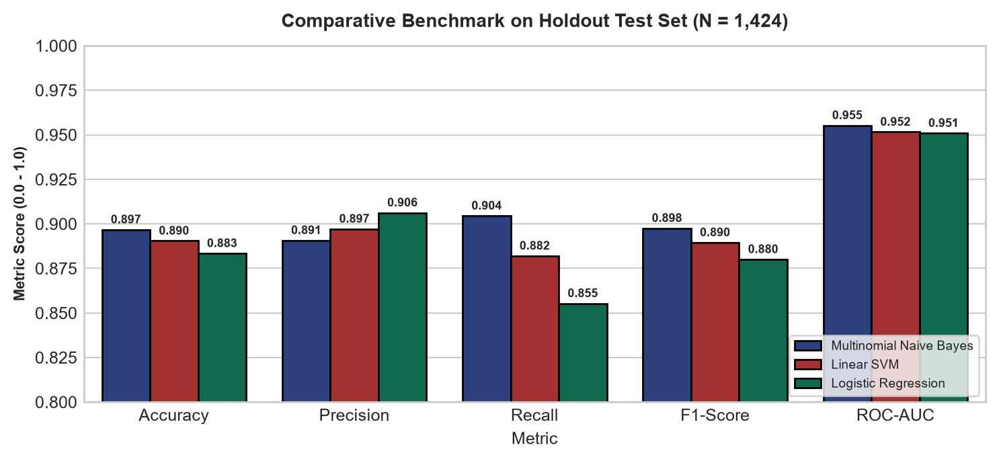
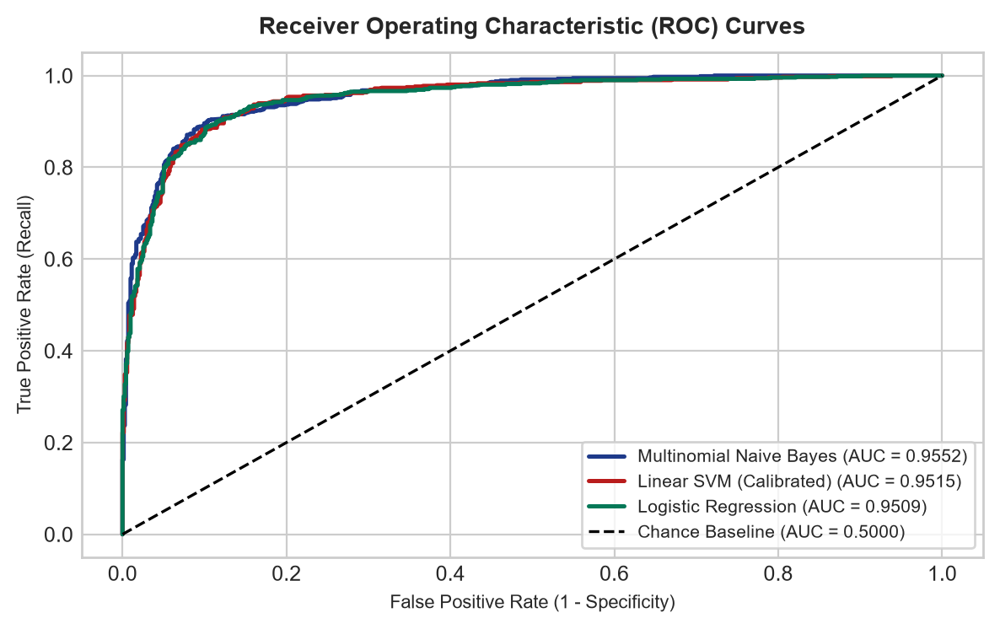

# 🔍 CrimeLens — AI Crime Detection Using NLP

An end-to-end Machine Learning and Natural Language Processing (NLP) system designed to classify textual incident descriptions and news headlines into binary categories: **CRIME (1)** vs. **NO CRIME (0)**.

Developed as an academic demonstration project highlighting rigorous data hygiene, negation-preserving text preprocessing, leak-proof TF-IDF feature pipelines, cross-validated model tuning, comprehensive empirical evaluation, and a modern Streamlit web interface.

---

## Table of Contents
1. [Project Overview](#1-project-overview)
2. [Domain & Legal Clarification](#2-domain--legal-clarification)
3. [Dataset Description & Audit](#3-dataset-description--audit)
4. [Methodology & Architecture](#4-methodology--architecture)
5. [Text Preprocessing & Negation Handling](#5-text-preprocessing--negation-handling)
6. [Feature Extraction (TF-IDF)](#6-feature-extraction-tf-idf)
7. [Machine Learning Algorithms](#7-machine-learning-algorithms)
8. [Experimental Results & Model Evaluation](#8-experimental-results--model-evaluation)
9. [Project Directory Structure](#9-project-directory-structure)
10. [Installation & Setup](#10-installation--setup)
11. [Execution Guide](#11-execution-guide)
12. [Limitations & Future Scope](#12-limitations--future-scope)

---

## 1. Project Overview

Digital media, social reporting feeds, and emergency dispatches generate thousands of textual updates every minute. For automated monitoring, threat detection, and societal sentiment indexing, rapid classification of text is vital.

This system accepts arbitrary textual descriptions and predicts whether the narrative depicts criminal activity:
- **`1` — CRIME**: Text describes violent crimes (assault, murder), property crimes (robbery, burglary, theft), financial fraud, drug operations, or legal charges/investigations.
- **`0` — NO CRIME**: Text describes benign human activities, sports competitions, community charity, business developments, health, and lifestyle journalism.

### Mandatory Deliverables Provided:
1. **`Crime_Detection_NLP.ipynb`**: A self-contained, 13-section academic Jupyter Notebook containing full data inspection, visual EDA, preprocessing demonstrations, cross-validation tuning, comparative evaluation charts, and pipeline export. All cells are executed and pre-rendered.
2. **`app/streamlit_app.py`**: An interactive, multi-page Streamlit web application loading the serialized model pipeline directly from disk with instant classification, probability breakdowns, and session history.

---

## 2. Domain & Legal Clarification

> **CRITICAL ETHICAL & ACADEMIC BOUNDARY:**  
> This project performs **text classification on published news headlines and reporting syntax**. It operates strictly on statistical token frequencies and semantic patterns learned from journalistic corpora.  
> The model **does not legally verify** whether an incident actually transpired, evaluate evidentiary guilt, determine criminal liability, or serve as a substitute for judicial fact-finding or law enforcement investigation.

---

## 3. Dataset Description & Audit

The model was trained and evaluated on the ground-truth Kaggle dataset `CrimeVsNoCrimeArticles.csv` preserved in `data/raw/`:

### Raw Dataset Statistics:
- **Total Records:** 7,124
- **Features:** 2 columns:
  - `title`: Input textual headline / incident description
  - `is_crime_report`: Target binary ground-truth label (`1` or `0`)
- **Raw Class Proportions:**
  - `0` (Non-Crime): 3,562 articles (50.0%)
  - `1` (Crime): 3,562 articles (50.0%)
- **Data Quality Audit Findings:**
  - Missing Values: Exactly 1 missing `title` record at row index 1353 (label 0).
  - Duplicate Records: Exactly 7 duplicated headline pairs across the corpus.

### Cleaned Dataset Statistics (Preserved in `data/processed/`):
- **Total Records after Sanitation:** 7,116
- **Cleaned Class Distribution:**
  - `0` (Non-Crime): 3,559 articles (50.01%)
  - `1` (Crime): 3,557 articles (49.99%)
- **Train-Test Partitioning (Stratified 80:20 Split, Random State = 42):**
  - **Training Split (80%):** 5,692 articles (2,847 class 0, 2,845 class 1)
  - **Holdout Test Split (20%):** 1,424 articles (712 class 0, 712 class 1)

<p align="center">
  
</p>

---

## 4. Methodology & Architecture

```
                                  [Raw Kaggle Dataset]
                                            │
                              [Data Hygiene & Deduplication]
                                            │
                        ┌───────────────────┴───────────────────┐
                        │                                       │
               [Training Set (80%)]                    [Holdout Test Set (20%)]
                 (5,692 articles)                         (1,424 articles)
                        │                                  (Strictly Unseen)
              [NLP Preprocessor]                                │
          - Lowercase & Unicode Strip                           │
          - Preserve Negations (not, no)                        │
          - WordNet Lemmatization                               │
                        │                                       │
              [TF-IDF Vectorization]                            │
             (1-2 N-Grams, 5000 Feats)                          │
                        │                                       │
           [Stratified 5-Fold Cross-Val]                        │
       ┌────────────────┼────────────────┐                      │
       │                │                │                      │
[Logistic Reg]  [Multinomial NB]   [Linear SVM]                 │
       │                │                │                      │
       └────────────────┬────────────────┘                      │
                        ▼                                       │
             [Model Benchmarking] ◄─────────────────────────────┘
                        │
             [Winning Model Selected]
          Multinomial Naive Bayes (MNB)
                        │
         ┌──────────────┴──────────────┐
         ▼                             ▼
[models/crime_classifier.joblib]  [models/model_metadata.json]
         │                             │
         └──────────────┬──────────────┘
                        ▼
           [Streamlit Interactive App]
```

---

## 5. Text Preprocessing & Negation Handling

Standard NLP stopword removal indiscriminately strips words like `not`, `no`, and `never`. In crime detection, this introduces fatal semantic inversions:
- *"Suspect was **not** charged, as there was **no** evidence of burglary."*  
  $\to$ Stripping negations converts this into: *"suspect charged evidence burglary"*, turning an acquittal into an erroneous crime classification!

### Preprocessing Protocol:
1. **Unicode Normalization (NFKD):** Converts accented and foreign glyphs to standardized ASCII.
2. **Case Folding:** Normalizes uppercase text to lowercase.
3. **Punctuation & URL Removal:** Strips hyperlinks and punctuation symbols.
4. **Negation Word Preservation:** Explicitly retains `{'no', 'not', 'nor', 'neither', 'never', 'none', 'nobody', 'nowhere', 'hardly', 'scarcely', 'barely', 'without', 'against'}`.
5. **Morphological Lemmatization:** Employs NLTK's `WordNetLemmatizer` to reduce nouns and verbs to their lexical root (e.g., *robbed*, *robbing*, *robberies* $\to$ *robbery* / *rob*).

---

## 6. Feature Extraction (TF-IDF)

Numerical feature vectors are computed using **Term Frequency-Inverse Document Frequency (TF-IDF)**:
- **N-Gram Range:** `(1, 2)` (captures both unigrams like `arrest` and bigrams like `armed robbery`, `not guilty`).
- **Maximum Features:** 5,000 most informative vocabulary terms.
- **Minimum Document Frequency (`min_df`):** 2 (filters out non-recurrent typos).
- **Sublinear Term Frequency Scaling:** Dampens high-frequency word counts.
- **Euclidean $L_2$ Normalization:** Normalizes document vector lengths for scale invariance.

> **Zero Data Leakage:** The TF-IDF vectorizer vocabulary and IDF weights are computed **strictly on training folds** inside Scikit-learn `Pipeline` objects. The holdout test set is never seen during vocabulary building or parameter tuning.

---

## 7. Machine Learning Algorithms

Three supervised classification algorithms were tuned via 5-fold cross-validation:

1. **Logistic Regression (`LogisticRegression`)**:
   - Parametric linear classifier modeling log-odds via the sigmoid function.
   - Tuned on $L_2$ inverse regularization parameter $C \in [0.5, 1.0, 2.0, 5.0]$.
2. **Multinomial Naive Bayes (`MultinomialNB`)**:
   - Probabilistic classifier tailored for discrete feature counts and TF-IDF representations.
   - Tuned on Laplace/Lidstone smoothing parameter $\alpha \in [0.1, 0.5, 1.0, 2.0]$.
3. **Linear Support Vector Machine (`LinearSVC` + `CalibratedClassifierCV`)**:
   - Convex optimization finding the maximum-margin separating hyperplane.
   - Calibrated using 3-fold Platt scaling (sigmoid calibration) to yield well-behaved posterior probabilities for the frontend.

---

## 8. Experimental Results & Model Evaluation

All models were evaluated on the **Holdout Test Set (1,424 articles)**:

### Benchmark Comparison Table:

| Model Architecture | Test Accuracy | Test Precision | Test Recall | Test F1-Score | Test ROC-AUC | Missed Crimes (FN) | False Alarms (FP) |
| :--- | :---: | :---: | :---: | :---: | :---: | :---: | :---: |
| **Multinomial Naive Bayes** | **89.68%** | **89.07%** | **90.45%** | **0.8976** | **0.9552** | **68** | **79** |
| **Linear SVM (Calibrated)** | **89.04%** | **89.71%** | **88.20%** | **0.8895** | **0.9515** | **84** | **72** |
| **Logistic Regression** | **88.34%** | **90.62%** | **85.53%** | **0.8801** | **0.9509** | **103** | **63** |

<p align="center">
  
</p>

### Confusion Matrices & ROC Curves:

<p align="center">
  
</p>

<p align="center">
  
</p>

### Winning Model Rationale:
**Multinomial Naive Bayes** was selected as the final production model:
1. **Highest F1-Score (0.8976):** Demonstrates superior harmonic balance between precision and recall.
2. **Lowest False Negatives (68 vs. 103 for Logistic Regression):** In safety triage, missing a violent incident (False Negative) is substantially more severe than a False Alarm (False Positive). MNB correctly retrieved 90.45% of all crime headlines.
3. **Highest ROC-AUC (0.9552):** Highest global class discrimination across varying decision thresholds.
4. **Computational Efficiency:** Ultra-low inference latency (< 5 ms per query) with zero specialized hardware requirements.

---

## 9. Project Directory Structure

```
CrimeLens/
│
├── Crime_Detection_NLP.ipynb      # Main Jupyter Notebook (All 13 Academic Sections executed)
│
├── app/
│   └── streamlit_app.py           # Multi-page interactive Streamlit web frontend
│
├── data/
│   ├── raw/
│   │   └── CrimeVsNoCrimeArticles.csv       # Preserved ground-truth dataset
│   │
│   └── processed/
│       └── CrimeVsNoCrimeArticles_cleaned.csv  # Cleaned, deduplicated dataset (7,116 rows)
│
├── models/
│   ├── crime_classifier.joblib    # Serialized winning pipeline (TF-IDF + MNB)
│   └── model_metadata.json        # Training date, hyperparameters, empirical test metrics
│
├── reports/
│   ├── Crime_Detection_NLP_Project_Report.pdf # Publication-grade technical report
│   └── figures/                   # High-resolution evaluation charts
│       ├── confusion_matrices.png
│       ├── eda_distribution.png
│       ├── model_comparison.png
│       └── roc_curves.png
│
├── src/
│   ├── __init__.py
│   └── preprocessing.py           # Negation-preserving text cleaning module
│
├── .streamlit/
│   └── config.toml                # Streamlit UI theme & headless server config
│
├── requirements.txt               # Pinned Python package dependencies
├── README.md                      # Comprehensive academic documentation
├── COMMANDS.md                    # Quick-reference terminal commands
├── run_frontend.bat               # Windows one-click launcher for Streamlit
├── run_notebook.bat               # Windows one-click launcher for Jupyter
└── .gitignore                     # Standard git ignore rules
```

---

## 10. Installation & Setup

### Prerequisites
- Python 3.11+
- Virtual environment tool (`venv` or `uv`)

### 1. Clone or Open the Repository
```bash
cd "c:/Users/sharm/OneDrive/Desktop/NLP Project"
```

### 2. Set Up a Python Virtual Environment
```bash
# Using standard venv
python -m venv .venv

# Activate on Windows PowerShell:
.venv\Scripts\Activate.ps1

# (Or on Command Prompt):
.venv\Scripts\activate.bat
```

### 3. Install Dependencies
```bash
pip install -r requirements.txt
```

### 4. Download Required NLTK Corpora (Automated or Manual)
```bash
python -c "import nltk; nltk.download('stopwords'); nltk.download('wordnet'); nltk.download('omw-1.4'); nltk.download('punkt')"
```

---

## 11. Execution Guide

### Running the Jupyter Notebook
You can open and re-run all notebook cells interactively:
```bash
jupyter notebook Crime_Detection_NLP.ipynb
```
*Note: The notebook is already pre-executed with all figures, classification tables, and plots saved.*

To programmatically execute the entire notebook headlessly:
```bash
python -m jupyter nbconvert --to notebook --execute --inplace Crime_Detection_NLP.ipynb
```

### Launching the Streamlit Web Application
Launch the interactive web UI:
```bash
streamlit run app/streamlit_app.py
```
Then open your browser to **`http://localhost:8501`**.

#### Features Available in the Frontend:
- **Home:** Executive summary, problem overview, and core test metrics.
- **Crime Prediction:** Interactive text input area, quick-load preset incident buttons (robbery, burglary, sports, wellness, negations), instant probability breakdown progress bars, and session prediction history.
- **Model Performance:** Comparative benchmark table, grouped metric bar chart, and confusion matrix heatmap loaded directly from `model_metadata.json`.
- **Dataset Information:** Audit statistics, schema breakdown, and an interactive data table of cleaned records.
- **About & Architecture:** Deep-dive into negation preservation, TF-IDF mechanics, and ethical disclosures.

---

## 12. Limitations & Future Scope

### Limitations
1. **Headline Brevity:** News headlines average 10–12 words. Elliptical phrasing and tabloid idioms can reduce contextual clarity.
2. **Figurative & Metaphorical Ambiguity:** Figurative headlines (e.g., *"Team slaughters opponents in cup final"*, *"Stock market crash kills investor savings"*) use violent vocabulary in non-criminal contexts.
3. **Statistical vs. Legal Guilt:** The model identifies linguistic reporting patterns; it does not determine legal truth, evidentiary admissibility, or guilt.

### Future Scope
1. **Contextual Transformer Embeddings:** Fine-tuning lightweight Transformer architectures (e.g., `distilbert-base-uncased` or `RoBERTa-large`) to capture deep syntax and metaphor context.
2. **Multi-Class Granularity:** Extending the target from binary classification to specific crime legal codes (e.g., Violent Crime, Property Crime, Cybercrime, Financial Fraud).
3. **Real-Time Stream Processing:** Integrating the pipeline with live RSS feeds or public dispatch feeds for real-time safety situational awareness.

