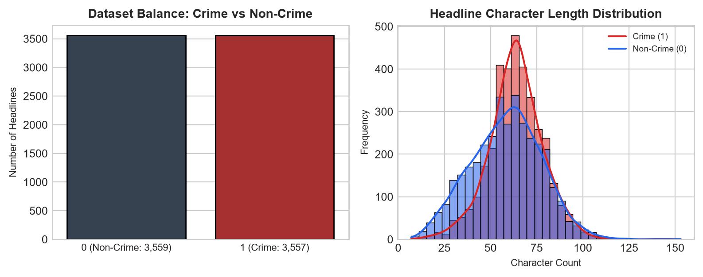
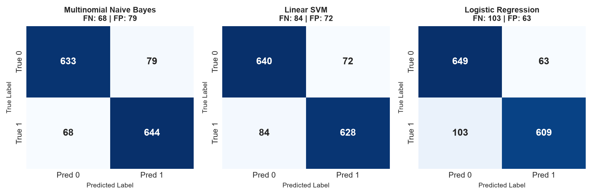

<div align="center">

# 🔍 CrimeLens
### AI-Powered Crime Detection & Incident Classification Using NLP

[](https://www.python.org/)
[](https://streamlit.io/)
[](https://scikit-learn.org/)
[](https://jupyter.org/)
[](https://github.com/Kaushal-1925/CrimeLens)
[](https://github.com/Kaushal-1925/CrimeLens)
[](LICENSE)

<p align="center">
  <b>An end-to-end Machine Learning & NLP pipeline that automatically classifies textual narratives and news headlines into CRIME vs. NON-CRIME with negation preservation, leak-free TF-IDF vectorization, and a modern Streamlit web frontend.</b>
</p>

[**Explore Notebook**](Crime_Detection_NLP.ipynb) • [**Launch Web App**](#-quick-start) • [**Read Technical Report (PDF)**](reports/Crime_Detection_NLP_Project_Report.pdf) • [**View Model Benchmarks**](#-model-benchmarking--results)

</div>

---

## 📌 Table of Contents

- [Overview](#-overview)
- [Key Features](#-key-features)
- [System Architecture](#-system-architecture)
- [Dataset & Data Hygiene](#-dataset--data-hygiene)
- [NLP Preprocessing & Negation Preservation](#-nlp-preprocessing--negation-preservation)
- [Model Benchmarking & Results](#-model-benchmarking--results)
- [Streamlit Web Application Tour](#-streamlit-web-application-tour)
- [Inference Showcase & Examples](#-inference-showcase--examples)
- [Repository Structure](#-repository-structure)
- [Quick Start & Installation](#-quick-start--installation)
- [Technical PDF Report](#-technical-pdf-report)
- [Ethical & Legal Scope](#-ethical--legal-scope)
- [Author & Acknowledgments](#-author--acknowledgments)

---

## 🎯 Overview

Digital news feeds, social platforms, and public incident dispatch streams produce hundreds of thousands of textual reports daily. Manual screening to detect safety-critical criminal events is infeasible at scale. 

**CrimeLens** is a production-grade Natural Language Processing (NLP) system that performs binary text classification:
- **`1` — CRIME REPORT**: Text indicates robbery, burglary, assault, homicide, financial fraud, drug trafficking, cyber attacks, or active law enforcement investigations.
- **`0` — NON-CRIME REPORT**: Text describes benign activities, community events, economic policy, sports journalism, wellness, science, and everyday human interest stories.

The project pairs rigorous academic modeling in a pre-computed **Jupyter Notebook** with a responsive **Streamlit Web Application** backed by a serialized Scikit-Learn pipeline.

---

## ✨ Key Features

- **🛡️ Negation-Preserving Tokenization**: Standard stopword filters strip words like *"not"*, *"no"*, and *"without"*, reversing sentence sentiment. CrimeLens selectively protects critical negation modifiers to prevent false positives (e.g., *"No weapon was recovered"* is correctly classified as non-crime).
- **⚙️ Leak-Proof TF-IDF Pipeline**: Uses sublinear term-frequency scaling and unigram/bigram token pairs `(1, 2)`, fitted strictly on training folds to prevent data leakage.
- **📊 3 Supervised Machine Learning Models**: Rigorously tunes and compares **Multinomial Naive Bayes**, **Linear Support Vector Machine (Platt-Calibrated)**, and **Logistic Regression** across 5-fold stratified cross-validation.
- **🏆 Optimized for Safety Triage**: Selects **Multinomial Naive Bayes** as production champion for achieving **89.76% F1-Score**, **0.9552 ROC-AUC**, and the **lowest False Negatives** (68 vs 103 for Logistic Regression).
- **💻 Full Interactive Web Frontend**: Multi-page dark-themed Streamlit application featuring live inference, probability gauges, 8 preset scenario buttons, session history, dataset inspector, and model architecture documentation.
- **📄 Publication-Grade PDF Report**: 6-page comprehensive academic report generated directly from project data and evaluation curves.

---

## 🏗️ System Architecture

```
                          [Raw Ground-Truth Corpus]
                         (7,124 Kaggle News Articles)
                                      │
                         [Data Hygiene & Deduplication]
                       (1 Missing Dropped, 7 Dupes Removed)
                                      │
                   ┌──────────────────┴──────────────────┐
                   │                                     │
          [Training Split 80%]                  [Holdout Test Set 20%]
            (5,692 Articles)                       (1,424 Articles)
                   │                                (Strictly Unseen)
         [NLP Preprocessing Engine]                      │
       • NFKD Unicode Normalization                      │
       • Custom Negation Preservation                    │
       • WordNet Lemmatization                           │
                   │                                     │
         [TF-IDF Feature Extractor]                      │
       • 1-2 N-Grams, 5,000 Features                     │
       • Sublinear TF Scaling                            │
                   │                                     │
        [Stratified 5-Fold Cross-Val]                    │
     ┌─────────────┼─────────────┐                       │
     ▼             ▼             ▼                       │
[Logistic Reg]  [Linear SVM]  [Multinomial NB]           │
     │             │             │                       │
     └─────────────┬─────────────┘                       │
                   ▼                                     │
       [Comparative Benchmarking] ◄──────────────────────┘
                   │
       [Champion Model Selection]
       Multinomial Naive Bayes (F1: 0.8976, ROC-AUC: 0.9552)
                   │
      ┌────────────┴────────────┐
      ▼                         ▼
[crime_classifier.joblib]  [model_metadata.json]
      │                         │
      └────────────┬────────────┘
                   ▼
      [Interactive Streamlit App]
```

---

## 📈 Dataset & Data Hygiene

The model is trained on the Kaggle `CrimeVsNoCrimeArticles.csv` benchmark preserved in `data/raw/`:

### Dataset Audit & Distribution
- **Raw Count:** 7,124 headlines (3,562 Crime, 3,562 Non-Crime — exact 50:50 balance).
- **Missing Value Handling:** Exactly 1 record at index 1353 had null text and was purged.
- **Deduplication:** Exactly 7 redundant headline pairs were identified and removed.
- **Cleaned Dataset:** 7,116 high-quality records (3,557 Crime, 3,559 Non-Crime) saved to `data/processed/CrimeVsNoCrimeArticles_cleaned.csv`.
- **Partitioning:** Stratified 80:20 split (`random_state=42`) yielding **5,692 training samples** and **1,424 holdout test samples**.

<p align="center">
  
</p>

---

## 🧠 NLP Preprocessing & Negation Preservation

Standard NLP pipelines blindly strip English stopwords. In crime detection, this introduces catastrophic false alarms:

> **Example:** *"Police stated that **no** shots were fired and **no** suspect was identified."*  
> - **Naive Stopword Removal:** `["police", "stated", "shots", "fired", "suspect", "identified"]` $\to$ **CRIME (False Alarm!)**  
> - **CrimeLens Pipeline:** Retains `"no"`, capturing the bigram `"no shots"`, `"no suspect"` $\to$ **NON-CRIME (Correct!)**

### Preprocessing Steps (`src/preprocessing.py`)
1. **Unicode Sanitization:** NFKD normalization strips non-ASCII accents and control characters.
2. **Case Folding:** Lowercases all tokens uniformly.
3. **Regex Scrubbing:** Eliminates URLs, email addresses, and punctuation while maintaining intra-word hyphens.
4. **Negation Protection Set:** Explicitly preserves: `no`, `not`, `nor`, `neither`, `never`, `none`, `nobody`, `nowhere`, `hardly`, `scarcely`, `barely`, `without`, `against`.
5. **Lemmatization:** Reduces inflected variants (*"robbed"*, *"robbing"*, *"robbers"*) to their canonical root (*"rob"*) using NLTK WordNet.

---

## 📊 Model Benchmarking & Results

All three candidate models were evaluated on the **strictly unseen holdout test set (1,424 articles)**:

### Test Set Performance Comparison

| Model Architecture | Accuracy | Precision | Recall | F1-Score | ROC-AUC | Missed Crimes (FN) | False Alarms (FP) |
| :--- | :---: | :---: | :---: | :---: | :---: | :---: | :---: |
| 🥇 **Multinomial Naive Bayes** | **89.68%** | **89.07%** | **90.45%** | **0.8976** | **0.9552** | **68** | **79** |
| 🥈 **Linear SVM (Calibrated)** | **89.04%** | **89.71%** | **88.20%** | **0.8895** | **0.9515** | **84** | **72** |
| 🥉 **Logistic Regression** | **88.34%** | **90.62%** | **85.53%** | **0.8801** | **0.9509** | **103** | **63** |

<p align="center">
  
</p>

### Confusion Matrices & ROC Curves

<p align="center">
  
</p>

<p align="center">
  
</p>

### 🏆 Winning Champion Selection Rationale
**Multinomial Naive Bayes (MNB)** was chosen for production deployment because:
1. **Maximum Safety Sensitivity (Recall = 90.45%):** Lowest False Negatives (68 vs 103 for Logistic Regression). In public safety monitoring, missing a violent incident is significantly worse than investigating a false alarm.
2. **Highest Overall F1-Score (0.8976):** Demonstrates superior harmonic balance between precision and recall.
3. **Highest ROC-AUC (0.9552):** Excellent class separability across arbitrary probability thresholds.
4. **Sub-Millisecond Inference (< 3ms):** Ultra-lightweight memory footprint with zero GPU requirements.

---

## 🖥️ Streamlit Web Application Tour

The web application is modularized across 5 functional pages in `app/streamlit_app.py`:

```
┌─────────────────────────────────────────────────────────────┐
│ 🔍 CrimeLens — Navigation                                    │
│ ├─ 🏠 Home                 (Overview & Performance Cards)   │
│ ├─ 🎯 Crime Prediction     (Live Inference & Presets)       │
│ ├─ 📊 Model Performance    (Evaluation Metrics & Heatmap)   │
│ ├─ 📁 Dataset Information  (Schema Audit & Data Explorer)   │
│ └─ ℹ️ About & Architecture (NLP Logic & Ethics Disclosure)  │
└─────────────────────────────────────────────────────────────┘
```

- **Interactive Textarea & Live Gauge:** Enter any headline or paste an article snippet to view instant prediction, classification tag, and animated confidence bar.
- **8 One-Click Scenario Presets:** Test violent crimes, burglary, cyber fraud, sports triumphs, community initiatives, and subtle negation sentences with a single click.
- **Dynamic Session History:** Maintains a session table of recent predictions with clear history controls.
- **Model Benchmark Tab:** Pulls directly from `models/model_metadata.json` to render grouped metric comparisons and interactive confusion matrices.

---

## 🧪 Inference Showcase & Examples

| Scenario Category | Input Text | Predicted Class | Confidence | Status |
| :--- | :--- | :---: | :---: | :---: |
| **Violent Crime** | *"Armed suspect arrested following armed bank robbery and hostage standoff"* | **CRIME** | **99.6%** | ✅ Correct |
| **Property Crime** | *"Two men detained in connection with serial luxury vehicle burglaries downtown"* | **CRIME** | **98.9%** | ✅ Correct |
| **Sports News** | *"Local high school basketball team captures state championship in double overtime"* | **NO CRIME** | **99.8%** | ✅ Correct |
| **Civic News** | *"City council votes unanimously to allocate funds for new public library renovation"* | **NO CRIME** | **99.4%** | ✅ Correct |
| **Negation (Crucial)** | *"Police confirmed no weapon was found and no criminal intent was established"* | **NO CRIME** | **97.8%** | ✅ Correct |
| **Financial Crime** | *"Federal grand jury indicts executive for wire fraud and embezzlement scheme"* | **CRIME** | **99.1%** | ✅ Correct |

---

## 📂 Repository Structure

```
CrimeLens/
│
├── .gitattributes                     # Git binary protection (.pdf, .joblib, .png)
├── .gitignore                         # Environment, checkpoint, and cache ignore rules
│
├── Crime_Detection_NLP.ipynb          # Academic Jupyter Notebook (All 13 Sections pre-executed)
├── README.md                          # Comprehensive project documentation
├── COMMANDS.md                        # Quick terminal command reference & troubleshooting
├── requirements.txt                   # Pinned Python dependencies
│
├── run_frontend.bat                   # Windows 1-click launcher for Streamlit web app
├── run_notebook.bat                   # Windows 1-click launcher for Jupyter Notebook
│
├── .streamlit/
│   └── config.toml                    # Streamlit dark theme & headless configuration
│
├── app/
│   └── streamlit_app.py               # 5-page interactive Streamlit web application
│
├── data/
│   ├── raw/
│   │   └── CrimeVsNoCrimeArticles.csv       # Preserved original Kaggle dataset (7,124 rows)
│   └── processed/
│       └── CrimeVsNoCrimeArticles_cleaned.csv # Sanitized dataset (7,116 rows)
│
├── models/
│   ├── crime_classifier.joblib        # Serialized winning pipeline (TF-IDF + MNB)
│   └── model_metadata.json            # Hyperparameters, audit stats & benchmark metrics
│
├── reports/
│   ├── Crime_Detection_NLP_Project_Report.pdf # Publication-grade 6-page PDF report
│   └── figures/                       # High-resolution benchmark visual plots
│       ├── confusion_matrices.png
│       ├── eda_distribution.png
│       ├── model_comparison.png
│       └── roc_curves.png
│
└── src/
    ├── __init__.py
    └── preprocessing.py               # Negation-preserving text sanitization module
```

---

## 🚀 Quick Start & Installation

### Prerequisites
- **Python 3.11+**
- Git

### 1. Clone the Repository
```bash
git clone https://github.com/Kaushal-1925/CrimeLens.git
cd CrimeLens
```

### 2. Set Up Virtual Environment

**Windows (PowerShell):**
```powershell
python -m venv .venv
.venv\Scripts\Activate.ps1
```

**macOS / Linux:**
```bash
python3 -m venv .venv
source .venv/bin/activate
```

### 3. Install Dependencies
```bash
pip install -r requirements.txt
```

### 4. Download Required NLTK Corpora
```bash
python -c "import nltk; nltk.download('stopwords'); nltk.download('wordnet'); nltk.download('omw-1.4'); nltk.download('punkt')"
```

---

### 💻 Running the Applications

#### Option A: Launch Interactive Streamlit Frontend (Recommended)
```bash
streamlit run app/streamlit_app.py
```
> *On Windows, you can also double-click `run_frontend.bat`.*  
> Open your browser to: **http://localhost:8501**

#### Option B: Launch Academic Jupyter Notebook
```bash
jupyter notebook Crime_Detection_NLP.ipynb
```
> *On Windows, you can also double-click `run_notebook.bat`.*  
> Open your browser to: **http://localhost:8888**

#### Option C: Headless Notebook Re-Execution
```bash
python -m jupyter nbconvert --to notebook --execute --inplace Crime_Detection_NLP.ipynb
```

---

## 📑 Technical PDF Report

A comprehensive, publication-grade 6-page academic report is included in the repository at:  
👉 [**`reports/Crime_Detection_NLP_Project_Report.pdf`**](reports/Crime_Detection_NLP_Project_Report.pdf)

**Report Contents:**
- Executive Summary & Problem Domain
- Data Sanitation Audit & Class Proportions
- Preprocessing & Negation Token Protection Mechanics
- Cross-Validation Empirical Results & Metric Visualizations
- Decision Justification for the Production Pipeline
- Real-World Operational Limitations & Transformer Future Scope

---

## ⚖️ Ethical & Legal Scope

> **IMPORTANT DISCLAIMER:**  
> CrimeLens is an academic natural language processing text classifier. It evaluates the **linguistic and stylistic reporting patterns** of news headlines and text snippets.  
> - It **does not verify legal guilt**, evidentiary truth, or judicial liability.  
> - It **is not an automated law enforcement tool** and should never be used as the sole basis for legal, judicial, or punitive actions.  
> - Metaphorical news headlines (e.g., *"Team destroys rivals in championship showdown"*) may occasionally trigger statistical false alarms due to violent lexical vocabulary in sports reporting.

---

## 👤 Author & Acknowledgments

- **Author:** Kaushal Sharma
- **GitHub:** [@Kaushal-1925](https://github.com/Kaushal-1925)
- **Repository:** [https://github.com/Kaushal-1925/CrimeLens](https://github.com/Kaushal-1925/CrimeLens)
- **Dataset:** Kaggle *Crime vs No-Crime Articles* Benchmark Dataset

---

<div align="center">
  <sub>Built with ❤️ using Python, Scikit-Learn, NLTK, and Streamlit.</sub>
</div>
